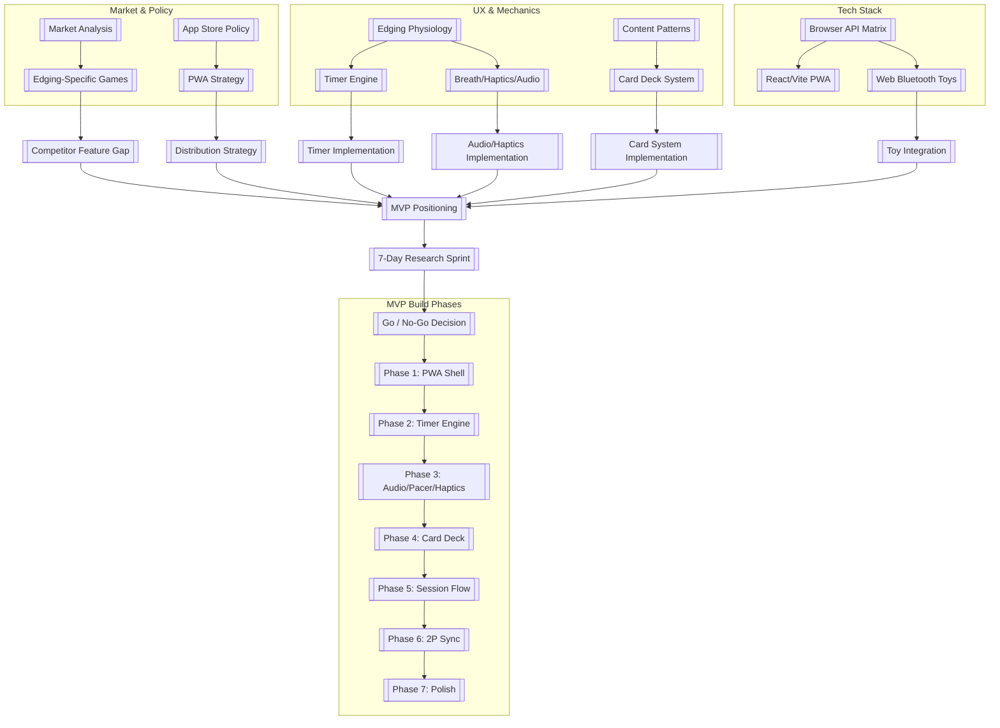

# 🎮 CoupleEdger — Project Master Index

> **18+ NSFW PWA for couples exploring edging together**
> **Stack**: React 18 + Vite + TypeScript + Zustand + Workbox PWA
> **Status**: ⏸️ Pre-Build — 7-Day Research Sprint Ready

---

## 📍 Start Here — Core Documents

- [[README]] — Project master map with full tree, checklists, sprint plan
- [[CLAUDE]] — Coding conventions, style, commands
- [[AGENTS]] — Agent behavior instructions
- [[docs/research/sprint-plan]] — 7-day pre-build research sprint (go/no-go checklist)

---

## 🗺️ Obsidian Canvas Graph (Mental Model)



---

## 📊 Research Deliverables

### App Store Landscape (Prompt 1–5)
| # | Research Area | Output File | Status |
|---|--------------|-------------|--------|
| 1 | Edging-specific games landscape | `docs/research/prompt-1.md` → `edging-games-research.md` | ⏳ Pending Sprint |
| 2 | Broad couple games landscape | `docs/research/prompt-2.md` → `couple-games-landscape.md` | ⏳ Pending Sprint |
| 3 | Edging mechanics & UX | `docs/research/prompt-3.md` → `edging-mechanics-ux.md` | ⏳ Pending Sprint |
| 4 | App store policies & PWA strategy | `docs/research/prompt-4.md` → `app-store-policy.md` | ⏳ Pending Sprint |
| 5 | Browser API support matrix | `docs/research/prompt-5.md` → `browser-api-matrix.md` | ⏳ Pending Sprint |

### Inclusive Design (Research + Clinical)
| # | Research Area | Output File | Status |
|---|--------------|-------------|--------|
| 6 | Inclusive edging design philosophy | `docs/research/inclusive-edging-design.md` | ✅ Created |
| 7 | Female arousal research findings | `docs/research/female-arousal-findings.md` | ✅ Created |
| 8 | Male arousal research findings | `docs/research/male-arousal-findings.md` | ✅ Created |
| 9 | Sensate Focus 5-level card system | `docs/research/sensate-focus-card-system.md` | ✅ Created |
| 10 | Inclusive timer design (combined) | `docs/design/inclusive-timer-design.md` | ✅ Created |
| 11 | Prostate-aware card deck | `src/data/prostateZoneDeck.json` | ✅ Created |
| 12 | Multi-Peak mode (ejaculatory control) | `docs/research/multi-peak-mode.md` | ✅ Created |
| 13 | Async LDR edging research | `docs/research/async-ldr-edging.md` | ✅ Created |
| 14 | 20 research prompts (all themes) | `docs/research/research-prompts.md` | ✅ Created |

---

## 🏗️ Build Artifacts (Pre-Generated)

| File | Purpose | Status |
|------|---------|--------|
| `package.json` | Dependencies + scripts | ✅ Created |
| `vite.config.ts` | Vite + Workbox PWA config | ✅ Created |
| `tsconfig.json` | TypeScript paths + strict mode | ✅ Created |
| `index.html` | SPA entry (age-gate bounce) | ✅ Created |
| `public/age-gate.html` | 18+ verification | ✅ Created |
| `src/data/coreDeck.json` | 25 inclusive cards (5 Sensate Focus levels + 5 Multi-Peak) | ✅ Created |
| `src/data/prostateZoneDeck.json` | 5 prostate-aware cards (external → optional internal) | ✅ Created |
| `src/data/dscProtocolDeck.json` | 10 D/s protocol cards (configurable) | ✅ Created |
| `src/data/sensoryDeprivationDeck.json` | 5 deprivation modes | ✅ Created |
| `src/data/groupModeDeck.json` | 5 three-person polyamory modes | ✅ Created |
| `src/data/asyncLDRDeck.json` | 6 async LDR command cards | ✅ Created |
| `docs/design/types-spec.md` | TypeScript type system + card deck spec | ✅ Created |
| `docs/design/tech-spec.md` | Implementation details (timer, audio, PWA, Bluetooth) | ✅ Created |
| `AGENTS.md` | Agent instructions | ✅ Created |
| `CLAUDE.md` | Conventions | ✅ Created |

---

## 🎯 MVP Feature Map

| Feature | Phase | Risk | Browser Support | Notes |
|--------|-------|------|-----------------|-------|
| Age gate + age-verified entry | 1 | Low | Universal | First thing user sees |
| 3-phase timer (rAF precision) | 2 | Medium | Universal | No `setInterval` |
| 5 presets (Warm-up→Ruin) | 2 | Low | Universal | Configurable durations |
| BPM stroke pacer (Web Audio) | 3 | Low | Universal | 6 synth sounds |
| Visual modes (3) | 3 | Low | Universal | Pulse/Flash/Breath |
| Voice coach (Web Speech) | 3 | Medium | Universal w/ iOS quirks | 7 languages |
| Haptic feedback | 3 | Medium | Android only | iOS requires gesture |
| Card deck system (20 cards) | 4 | Low | Universal | 5 types × 5 intensities |
| Secret timer (giver-only UI) | 5 | Medium | Universal | Asymmetric info |
| Session flow (negotiation→aftercare) | 5 | Medium | Universal | Full state machine |
| Two-player sync (same-room) | 6 | High | WebRTC capable | WebSocket signaling |
| Aftercare system | 5 | Medium | Universal | Debrief prompts + cuddle timer |
| Web Bluetooth toy integration | 7/stretch | High | Android/Desktop only | iOS unsupported |

---

## 📈 MVP Success Metrics

| Metric | Target | Measurement |
|--------|--------|-------------|
| Session initiation rate | >60% | Users who complete negotiation & start session |
| Session completion rate | >70% | Sessions reaching Resolution phase |
| Edge count (denial mode) | ≥10 avg | Logged edges per session |
| 7-day return rate | >35% | PWA install retention |
| PWA install rate | >20% | `"beforeinstallprompt"` accepts |
| Timer accuracy | <100ms drift/30min | `performance.now()` vs wall clock |
| Crash-free sessions | >99.5% | Sentry or manual |

---

## 🔗 Research Prompts (for agents)

- [[docs/research/prompt-1|Prompt 1]]: Edging-specific games deep-dive
- [[docs/research/prompt-2|Prompt 2]]: Broad couple games landscape
- [[docs/research/prompt-3|Prompt 3]]: Edging mechanics & UX
- [[docs/research/prompt-4|Prompt 4]]: App store policy & PWA strategy
- [[docs/research/prompt-5|Prompt 5]]: Browser API matrix
- [[docs/research/inclusive-edging-design|Bonus]]: Inclusive design philosophy + Kegel integration + trans health research

### Inclusive Design Prompts (20 agent-ready)
- [[docs/research/inclusive-edging-design|Inclusive Design Philosophy]] — breakthrough features
- [[docs/research/research-prompts|Research Prompts Pack]] — 20 copy-paste prompts

---

## 🎯 Inclusive MVP Feature Map (Enhanced)

| Feature | Phase | Priority | Notes |
|--------|-------|----------|-------|
| Universal Anatomy Mode | 5 | 🔴 High | Anatomy-neutral zone cards (all genders) |
| Switch Roles Mid-Session | 5 | 🔴 High | Equality + stamina for both partners |
| Sensory Mapping | 4 | 🔴 High | Visual/auditory/tactile tags per card |
| Multi-Peak Timer Mode | 3 | 🟡 Medium | Based on non-linear female arousal |
| Async Remote Mode | 7 | 🟡 Medium | Command cards via shareable link |
| Environment Sync | 7 | 🟢 Low | Hue/smart speaker integration |
| Biometric Adaptive | 7 | 🟢 Low | HRV-based BPM adjustment |
| Local AI Voice Coach | 7 | 🟢 Low | On-device generated commands |

---

## 🚀 Quick Start Commands

```bash
# Navigate to project
cd couple-edger

# Install dependencies (after scaffold is set up)
npm install

# Start dev server
npm run dev

# Type-check
npm run typecheck

# Lint
npm run lint

# Build
npm run build

# Test
npm run test
```

---

## ⚠️ Constraints & Guidelines

1. **18+ ONLY** — age verification mandatory on all entry points
2. **No user-generated media** — text-only UGC only (if ever added)
3. **PWA-first** — no app stores due to adult content policies
4. **Client-side everything** — timer, audio, voice, haptics, storage
5. **Consensual design** — safeword always available, aftercare always included
6. **Kink-safe content** — RACK/SSC principles, no non-consent themes
7. **No illegal content** — no incest, no minors, no non-consensual
8. **Respect browser limits** — no Web Bluetooth on iOS, graceful degradation
9. **Inclusive by design** — works for all genders, orientations, relationship structures
10. **Switch-friendly** — any partner can be giver/receiver/dominant/submissive

---
*Generated: 2026-10-15* — Ready for 7-day research sprint + inclusive design research.